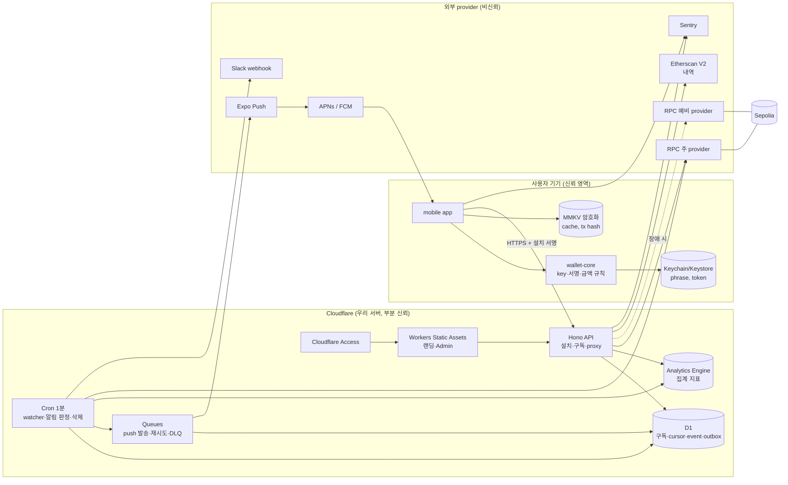
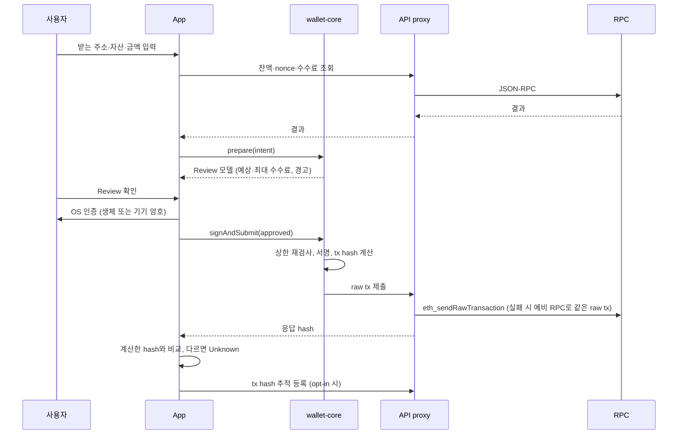
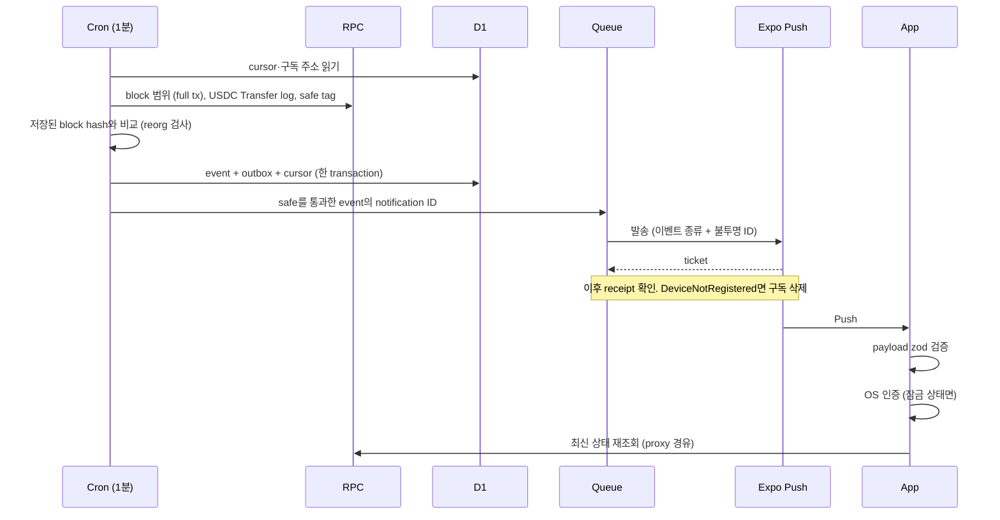
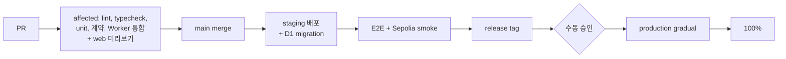

# VaultMe HLD (High-Level Design)

작성일: 2026-10-12 · 상태: 설계 초안 (구현·배포 없음) · 근거: [요구사항 결정 기록](../vaultme-requirements-session.md) Q1–Q76

이 문서는 큰 틀의 구조, 스펙, 제약을 정한다. 코드 수준 결정은 [LLD](lld.md)에 있다. 화면 흐름은 [UX 흐름](ux-flow.md)에 있다.

이 문서는 설계다. 실제 wallet runtime, Testnet 배포, 측정 결과가 아니다. "목표"와 "실측"을 구분한다.

## 1. 목적과 범위

### 1.1 제품 목표

- Seed phrase 기반 EOA 자가수탁 지갑의 송신·수신·상태 확인 흐름을 Sepolia에서 검증한다.
- 앱 밖에서도 거래 결과와 입금을 Push로 알린다.
- Frontend Engineer 포트폴리오로 쓴다. React Native 앱, React·TS Admin, 인증·보안 저장소, 상태 관리, 폼 검증, Expo/EAS를 실제 제품 이유와 함께 보여준다.

### 1.2 첫 버전 범위

| 포함 | 제외 (후속) |
|---|---|
| 신규 생성(12단어), 기존 복구(12·24단어) | 다중 계정·다른 derivation path 탐색, BIP39 passphrase |
| 지갑 1개, EVM 계정 1개 (`m/44'/60'/0'/0/0`) | Smart Account, ERC-4337, EIP-7702, Passkey |
| Ethereum Sepolia | 다중 체인, Mainnet |
| Native ETH + Circle Sepolia USDC (6 decimals) | 임의 토큰, swap, token approval |
| 송신 (직접 입력·붙여넣기·QR), 수신 (주소 QR) | 금액 지정 요청 QR, 주소록, ENS |
| Pending 재조회·explorer 링크 | Speed-up/cancel (replacement transaction), 동시 송신 |
| 입금·송신 결과 Push (opt-in) | 암호화 클라우드 백업, WalletConnect, dApp 연결 |
| 공개 랜딩 (SEO), 읽기 전용 운영 대시보드 | 사용자 조회·조작 Admin, 제품 분석 퍼널 |

## 2. 시스템 구성

### 2.1 배포 단위

| 단위 | 기술 | 책임 |
|---|---|---|
| `apps/mobile` | Expo (dev build, EAS) + React Native + TS | Key 생성·보관·서명, 송신·수신 UX, 내역 표시, Push 수신 |
| `apps/web` | React Router v7 (`ssr: false`, 랜딩만 prerender), 별도 Worker + Static Assets (ADR-0001) | 공개 랜딩, 운영 대시보드 (Cloudflare Access 뒤) |
| `apps/api` | Cloudflare Workers + Hono + Cron + Queues + D1 | 설치 등록, 구독·session, 내역·RPC proxy, watcher, Push 발송, 데이터 삭제, 지표 |
| `packages/wallet-core` | 순수 TS + viem | Key 파생, 거래 구성, 서명, 금액 규칙, 송신 상태 전이 |
| `packages/contracts` | zod + OpenAPI | API 계약, 공유 schema |
| `packages/tokens` | Style Dictionary 생성물 | Foundation token (TS 상수, CSS 변수) |

### 2.2 시스템 구조도

### 2.3 책임 경계 원칙

1. **Key와 서명은 기기에만 있다.** 서버는 seed, private key, 서명 권한을 갖지 않는다 (Q24).
2. **안전에 중요한 값은 서버에서 받지 않는다.** Chain ID, USDC contract 주소, decimals, derivation path는 `wallet-core` 상수다. tx hash는 앱이 직접 계산한다 (Q73).
3. **서명 경계는 package 경계다.** 화면 코드는 `wallet-core`의 좁은 interface만 호출한다. Lint가 import를 제한한다 (Q59).
4. **서버는 알림과 proxy를 맡는다.** 내역을 저장하지 않는다 (Q30, Q32).
5. **Push는 신호다.** 데이터의 원본이 아니다. 앱은 알림 후 서버/RPC에서 상태를 다시 읽는다 (Q23, Q29).

## 3. 주요 데이터 흐름

### 3.1 송신

- 제출 직전 필요한 수수료 상한이 승인한 상한보다 높으면 Review로 돌아가고 다시 인증한다 (Q46).
- 기기 안의 절대 수수료 상한을 넘으면 송신을 막는다 (Q73).
- Pending 또는 Unknown 송신이 있으면 새 송신을 막는다 (Q47).

### 3.2 입금 감지와 Push

### 3.3 구독 (opt-in)

1. 첫 송신 제출 직후 또는 수신 화면 첫 진입 때 설명 화면을 보여준다 (Q27).
2. 사용자가 켜면 OS 알림 권한을 요청한다.
3. OS 인증 후 앱이 서버 challenge(SIWE 형식, 1회용 nonce, 만료)에 서명한다 (Q28).
4. 서버가 서명을 검증하고 기기 session을 발급한다. 주소 ↔ push token을 저장한다.
5. Settings에서 끄면 서버의 연결을 삭제한다.

### 3.4 내역 조회

- 앱 → proxy → Etherscan V2 (`txlist`, `txlistinternal`, `tokentx`) → proxy가 합치고 중복 제거 → 앱.
- 서버는 내역을 저장하지 않는다. 주소를 로그에 남기지 않는다.
- 앱은 마지막 결과를 MMKV에 저장하고 업데이트 시각과 함께 표시한다 (Q58).
- 0원 transfer는 기본으로 숨긴다 (Q71).

## 4. 상태 모델

### 4.1 송신 상태

| 상태 | 의미 | 표시 |
|---|---|---|
| Draft | 입력 중 | — |
| Reviewing | Review 표시, 인증 전 | 예상·최대 수수료, 경고 |
| Authenticating | OS 인증 중 | — |
| Submitting | 제출 요청 중 | 진행 표시 |
| Pending | 제출 확인됨, receipt 없음 | 재조회, 마지막 확인 시각, explorer 링크 |
| Unknown | 제출 결과를 알 수 없음, hash 불일치, 조회 실패 | Pending과 별도 문구 |
| Included | receipt 있음, `safe` 이전 | "Block에 포함됨 (확정 대기)" |
| Confirmed | 성공 receipt가 `safe` 통과 | Confirmed |
| Failed | 실패(reverted) receipt가 `safe` 통과 | Failed |
| Replaced | `safe` 기준 계정 nonce > 우리 nonce, 우리 hash의 receipt 없음 (같은 nonce의 다른 거래 확정) | "다른 거래가 먼저 처리되어 이 송신은 실행되지 않았습니다" (Q77) |

- 시간 경과만으로 Failed로 바꾸지 않는다. 자동 재송신하지 않는다 (Q22).
- Replaced는 체인 사실 판정이다. 송신 차단(Q47)을 해제하고 Push로 알린다 (Q77).
- 상세 전이표는 [LLD §6](lld.md#6-송신-상태-전이)에 있다.

### 4.2 확정 기준

- Sepolia의 `safe` block tag를 Confirmed 기준으로 쓴다 (Q37).
- 입금 Push, 송신 결과 Push, 앱 화면에 같은 기준을 적용한다.
- 실제 지연은 실측한다.

## 5. 데이터 위치와 보관

| 데이터 | 위치 | 보관 |
|---|---|---|
| Seed phrase | Keychain/Keystore, `BIOMETRY_ANY_OR_DEVICE_PASSCODE`, 이 기기 전용, 백업 제외 | 지갑 삭제까지 |
| 설치 token, 기기 session | Keychain (인증 없는 등급) | 만료·삭제까지 |
| 잔액·내역 cache, Pending tx hash, 이전 수신자 목록, UI 상태 | MMKV (암호화, key는 keychain) | 기기 |
| 구독 (주소 ↔ push token) | D1 | 해지, token 무효, 90일 미접속 시 삭제 |
| 감지 event, outbox, receipt, 추적 tx hash | D1 | 최종 처리 후 7일 |
| 집계 지표 (주소 없음) | Analytics Engine | 장기 |
| 구조화 로그 (주소 없음, 요청 ID) | Workers Logs | 플랫폼 기본 |
| 크래시·성능 (주소·금액·hash 제거) | Sentry | Sentry 기본 |

개인정보 고지: 내역·RPC proxy를 통해 opt-in하지 않은 사용자의 주소도 서버를 지나간다. 저장하지 않지만 고지한다 (Q32, Q58).

## 6. 비기능 요구 (NFR)와 SLO

| 항목 | 목표 | 측정 |
|---|---|---|
| 입금 감지 | p95 ≤ 2분 (`safe` 통과 → Expo 발송 요청) | Analytics Engine, Admin |
| API 가용성 | 월 99.5% | 5xx·timeout 비율 |
| Push 발송 성공률 | 추적 (목표값은 실측 후 설정) | Expo receipt |
| 앱 성능 | 실측 대상: 앱 시작, key 파생, 송신 흐름 | Sentry performance |
| 접근성 | WCAG 2.2 AA, VoiceOver·TalkBack으로 핵심 흐름 완주 | 수동 체크리스트, axe |

알림 (Slack webhook, 30분 중복 억제, 복구 알림): watcher cursor 5분 이상 정지, dead-letter 1건 이상, API 5xx 급증 (Q56, Q69).

목표는 가설이다. 실측 전에는 달성으로 보고하지 않는다.

## 7. 보안과 위협 모델

### 7.1 지킬 자산

1. Seed phrase와 파생 key → 자금 그 자체
2. 송신 승인 (받는 주소, 금액, 수수료)
3. 주소 ↔ 기기 연결 (개인정보)
4. Provider key, Expo access token, Slack webhook
5. 서비스 가용성 (watcher, proxy)

### 7.2 신뢰 경계

| 경계 | 넘어오는 데이터 | 처리 원칙 |
|---|---|---|
| 사용자 입력 → 앱 | 주소, 금액 | contracts schema + `wallet-core` 규칙 검증 |
| QR·클립보드 → 앱 | 주소, EIP-681 | 형식 검증, chain ID 불일치 경고, 금액 무시 |
| 서버 → 앱 | 잔액, 내역, 수수료, receipt | 응답 schema 검증. 안전 값은 받지 않음. 출처·시각 표시 |
| Push → 앱 | 이벤트 종류, ID | zod 검증, URL 무시, 서버 재조회 |
| 앱 → 서버 | 설치 서명 요청, SIWE 서명 | 서명·nonce·만료 검증, rate limit |
| provider → 서버 | 체인 데이터 | 예비 provider 전환, reorg 재확인 |

### 7.3 위협과 대응 (STRIDE 요약)

| 위협 | 분류 | 대응 | 남은 위험 |
|---|---|---|---|
| 기기를 빌린 사람의 송신 | S, E | 송신마다 OS 인증, 30초 잠금 (Q12, Q13) | 기기 암호를 아는 사람 |
| Phrase 사본 유출 (캡처, 사진첩) | I | 복사 금지, phrase 화면 캡처 차단, 앱 전환 가림 (Q43) | iOS 차단은 비공식 기법 |
| 생체 등록 변경으로 지갑 잠김 | D | `BIOMETRY_ANY_OR_DEVICE_PASSCODE` (Q34) | Android 동작 실측 필요 |
| 주소 오염 | S | 0원 숨김, 첫 수신자 안내, 유사 주소 경고, 4글자 분할 (Q71), burn·토큰 컨트랙트 수신자 경고 (Q79) | — |
| 클립보드 바꿔치기 | T | 위 방어 + 비교 안내 (Q72) | 감염된 기기 |
| 서버 거짓 데이터 | T | 안전 값 상수화, 기기 서명, hash 직접 계산, 절대 수수료 상한 (Q73) | 잔액·내역·receipt 조작 |
| 공급망 공격 | T, I | 7일 release age, `wallet-core` 의존성 허용 목록, SHA 고정 (Q74) | 같은 JS 환경의 다른 패키지 |
| 가짜 Push | S | Expo 발송 인증, payload 검증, deep link 무시, 안내 문구 (Q75) | 다른 앱·SMS 피싱 |
| Proxy 남용 | D | 설치 token + 요청 서명 + 설치·IP rate limit (Q57) | 앱 분석으로 서명 방식 노출 |
| 구독 탈취·덮어쓰기 | S, T | SIWE 소유 증명, 기기 session (Q28) | — |
| 이중 송금 | T | Pending·Unknown 중 송신 차단 (Q47) | — |
| 루팅·탈옥 기기 | E, I | 탐지 시 경고 표시, 사용은 허용 | 탐지 우회. 감염 기기와 같은 수준으로 수용 |
| Admin 노출 | E | Cloudflare Access, 읽기 전용, 주소 없는 지표 (Q44, Q57) | — |

## 8. 장애 대응

| 장애 | 동작 |
|---|---|
| RPC 주 provider | 서버가 예비 provider로 전환. 같은 raw tx 재전송은 안전 |
| Etherscan | 기기의 마지막 내역과 업데이트 시각 표시. 보낸 거래는 hash로 계속 추적 |
| Expo Push | 알림 지연·누락. 앱 안 상태 확인은 동작 |
| Watcher 정지 | 재시작 후 cursor부터 다시 읽음. 늦은 입금도 한 번만 알림. 5분 정지 시 Slack 알림 |
| Cloudflare 전체 | 수용. 앱은 cache 표시, 송신 불가 |
| 앱 강제 종료 중 제출 | 기기에 저장한 tx hash로 재조회. 결과 불명이면 Unknown |

## 9. 저장소·환경·배포

### 9.1 Repository

pnpm workspaces + Turborepo monorepo (Q51). 앱·웹·API·공유 package가 한 commit으로 계약을 바꾼다.

### 9.2 환경

| 환경 | 용도 | 리소스 |
|---|---|---|
| local | 개발 | 로컬 D1, anvil, Expo dev client |
| staging | 통합·migration·배포 리허설 | 전용 D1·Queue·secret·provider key, EAS `staging` channel |
| production | 외부 평가자용 공개 환경 (Sepolia) | 전용 리소스, EAS `production` channel |

웹은 PR마다 Workers 미리보기 URL을 쓴다 (Q52, ADR-0001). Workers Builds 또는 `wrangler versions upload --preview-alias pr-<number>`를 쓴다.

### 9.3 Zero downtime 원칙

예전 모바일 앱이 계속 동작하는 것을 기준으로 삼는다 (Q53).

1. **API**: v1은 필드 추가만 허용한다. 깨지는 변경은 `/v2`. 앱 버전 header, 최소 지원 버전 미만이면 업데이트 안내.
2. **D1**: expand → 새 코드 배포 → 데이터 이전 → contract. 한 migration에 열 삭제·이름 변경·테이블 재생성 금지.
3. **Workers**: gradual deployment, 오류율 확인 후 확대, 이상 시 rollback.
4. **Web**: Workers Static Assets 원자 배포. 배포는 100% 단일 버전(gradual 미사용: HTML·asset 버전 불일치 위험), 이상 시 `wrangler rollback` (ADR-0001). Web과 API는 별도 Worker로 둔다.
5. **Mobile**: JS 변경은 EAS Update, native 변경은 store 빌드, runtime version으로 비호환 업데이트 차단.

### 9.4 CI/CD 큰 흐름

관문: OpenAPI 깨지는 변경, migration lint, `wallet-core` 의존성 허용 목록, 취약점 검사 (Q55, Q61, Q66, Q74). 상세는 [LLD §9](lld.md#9-cicd-pipeline).

## 10. 테스트 전략

위험 목록마다 가장 싼 테스트 레벨을 지정한다. 커버리지 %가 아니라 위험 목록으로 완료를 판단한다 (Q54).

| 위험 | 레벨 |
|---|---|
| 금액 계산 (decimal, Max, 수수료 상한) | unit + property |
| 송신 상태 전이, 재인증 규칙 | unit + property |
| API 계약, 예전 앱 호환 | 계약 테스트, OpenAPI diff |
| Watcher reorg·중복·cursor 복구 | Worker 통합 (로컬 D1 + anvil) |
| 핵심 사용자 흐름 | 모바일 E2E (소수), 웹 E2E |
| Keychain, 캡처 차단, 생체인증, 스크린 리더 | 실기기 수동 체크리스트 |
| 전체 연결 | staging Sepolia smoke |

## 11. 실측으로 확정할 항목

| 항목 | 결정 | 확인 방법 |
|---|---|---|
| Etherscan 입금·내부 native, pagination | Q36 | ✅ Etherscan 유지 ([측정](../../work/measurements/etherscan-sepolia-2026-10-14.md)). internal 입금은 `txlistinternal`로만 얻는다. Sepolia `tokentx`의 가짜 `ETH` 행은 버린다. Alchemy는 문서상 Sepolia internal 없음 |
| RPC 주·예비 provider | Q36, Q58, Q78 | ✅ 주 Infura, 예비 Alchemy |
| `safe` 확정 지연 | Q37 | 1차 실측: 최신 대비 408–768초, 포함→`safe` 약 7–13분 ([측정](../../work/measurements/sepolia-safe-lag-2026-10-12.md)). staging에서 재측정 |
| Circle USDC 주소, faucet 한도 | Q41 | ✅ `0x1c7D…7238`, decimals 6 on-chain 확인, faucet 20 USDC/2시간 |
| Hermes key 파생 속도 | Q33, Q60 | Sentry 측정 → native crypto 필요 여부 |
| Android 생체 변경 시 key 무효화 | Q34 | 실기기 |
| iOS 캡처 차단 | Q43 | iOS 버전별 실기기 |
| MMKV New Architecture 요구 | Q63 | 구현 시 |
| anvil reorg 재현 | Q67 | 구현 시 |
| Expo 발송 인증 설정 | Q75 | Expo 문서 |

## 12. 열린 질문

없음. Q77(다른 지갑의 같은 nonce 사용)은 Replaced 상태로 결정했다.
