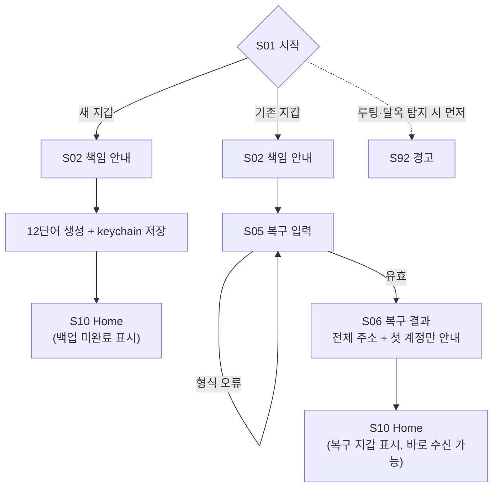
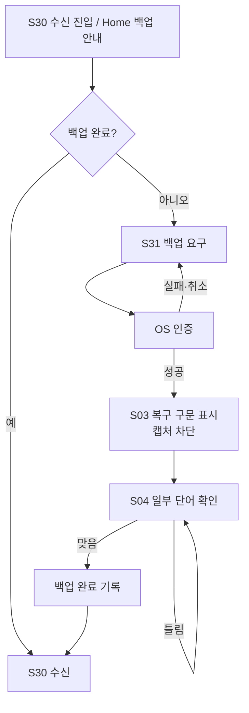
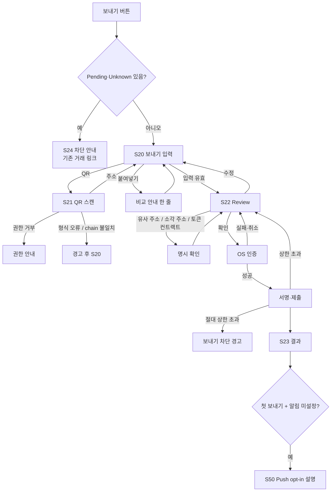
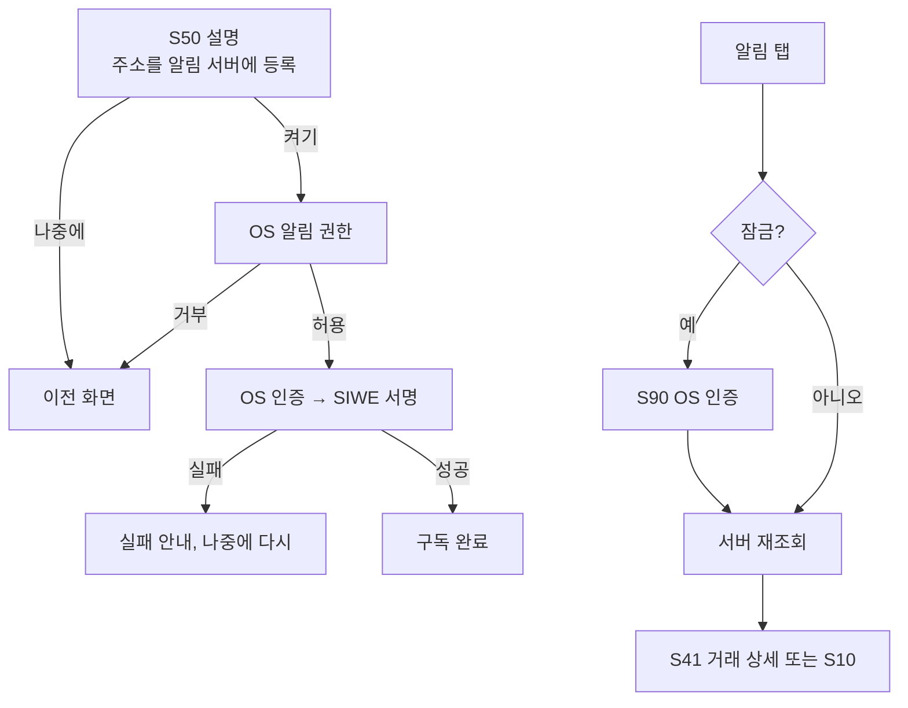

# VaultMe UX 화면 흐름

작성일: 2026-10-12 · 상태: 설계 초안 · 상위 문서: [HLD](hld.md), [LLD](lld.md) · 근거: [요구사항 결정 기록](../vaultme-requirements-session.md)

이 문서는 첫 버전의 화면 목록, 분기, 상태를 정한다. Figma·Make Prototype은 이 문서와 Foundation 계약([컴포넌트 C01–C28](../components/README.md))을 따른다. 기존 Make Kit은 재사용 후보다. 전체 전환이 동작한다고 가정하지 않는다 ([검토](../make-kit-review-2026-10-11.md)).

## 1. Manyfast 흐름과의 차이

| Manyfast 흐름 | 첫 버전 | 이유 |
|---|---|---|
| 멀티체인 자산 목록, 자산 검색 | ETH + USDC 두 줄 (Sepolia) | Q35, Q41 |
| 앱 잠금 설정 화면 | 없음. OS 인증 사용 | 별도 PIN 없음 |
| 시드 검증 → 바로 완료 | Home 먼저, 수신 전에 백업 확인 | Q14 |
| 자산 변환 (Swap) | 제외 | 범위 밖 |
| 잔액·평가금액 | 수량만. 평가금액 `Unavailable` | Q48 |
| 루팅·탈옥 안내 | 경고만 표시, 사용은 막지 않음 | 탐지는 우회 가능. 위험 고지 목적 |
| — (없음) | Push opt-in, 유사 주소·소각 주소·토큰 컨트랙트 경고, Replaced 상태, dark mode (OS 설정 따름) | Q27, Q71, Q77, Q79, Q80 |

## 2. 화면 목록

| ID | 화면 | 주요 컴포넌트 |
|---|---|---|
| S01 | 시작 (생성 / 복구 선택) | C01 Button |
| S02 | 책임 안내 (자가수탁, 복구 구문 분실 시 복구 불가, 알림으로 복구 구문 요청 안 함) | C25 Status notice |
| S03 | 복구 구문 표시 (12단어, 캡처 차단, 복사 없음) | C19 Backup status |
| S04 | 일부 단어 확인. Figma `Flow 1` B-S04 423:15243 (빈 칸) · 입력 중 · 틀림(틀린 칸만 Invalid + "N번째 단어가 달라요") · 모두 입력, 2026-10-17 | B/Input |
| S05 | 복구 입력 (12·24단어, 번호 붙은 단어 칸 + 선택 패스프레이즈, 2026-10-17 오너). Figma `Flow 1` B-S05 423:15293 (빈 칸 12) · 입력 중 565:85343 · 모든 단어(패스프레이즈 접힘) 565:85483 · 복구 중 565:85628 · 모르는 단어 565:85778 · 순서 오류 565:85919 · 이미 지갑 있음 565:86060 · 저장 실패 565:86214 · 패스프레이즈 가림 565:86368 · 패스프레이즈 보기 565:86527 · 24단어 입력 중 565:86684. Dark: 430:16003, 565:75157, 565:75203, 565:75249, 565:75295, 565:75342, 565:75389, 565:75437, 565:78059, 565:78106, 565:78153. 이전 단일 입력 프레임은 `Archive · 14 Removed frames` | B/Word cell, B/Chip, B/Button(Ghost sm), B/Settings row, B/Input(Show action), B/Notice (Banner Danger) |
| S06 | 복구 결과 (전체 주소, 첫 계정 경로 안내). Figma B-S06 423:13703 · 복사됨 · 패스프레이즈 565:86884 (Dark 565:78211, 제목 아래 "패스프레이즈로 복구했어요.") | B/Detail row |
| S10 | Home | C22, C23 Portfolio balance, C09 Asset row, C25 (백업 안내 1개) |
| S11 | 자산 상세 | C09, C10 Activity row |
| S20 | 보내기 입력 | C08, C12 Recipient field, C13 Amount field |
| S21 | QR 스캔 | 카메라, C25 |
| S22 | Review | C15 Transaction panel, C14 Fee summary, C24 Review footer, C25 경고 |
| S23 | 보내기 결과 / 상태 | C28 Result, C05 Status label |
| S24 | 보내기 차단 안내 (Pending·Unknown 존재) | C25, C10 |
| S30 | 수신 (QR, 전체 주소, network, 복사·공유, "테스트 ETH 받기" faucet 행 2026-10-17) | C11 Receive address |
| S31 | 수신 전 백업 요구 (신규 지갑) | C19, C01 |
| S40 | 내역 | C10, C27 Collection state |
| S41 | 거래 상세 (explorer 링크, 재조회, 마지막 확인 시각) | C26, C05 |
| S50 | Push opt-in 설명 | C25, C01 |
| S60 | Settings | C06 |
| S61 | 복구 구문 다시 보기 (OS 인증 후) | C19 |
| S62 | 알림 설정 (켜기/끄기) | C06 |
| S63 | 0원 거래 표시 설정 | C06 |
| S64 | 오픈소스 라이선스 (설정 › 정보 › 오픈소스 라이선스, 2026-10-17 오너 결정). 목록은 빌드 때 lockfile에서 간접 의존성까지 자동 생성 | B/Settings row |
| S65 | 라이선스 전문 (S64 행 누름 → 패키지 이름 · 버전 · 저작권 줄 · 전문, 세로 스크롤. 2026-10-17 오너 결정) | Title block + Section band + 본문(Body Small) |
| S90 | 잠금 (OS 인증 요청) | C01 |
| S91 | 앱 업데이트 필요 (`426`) | C28 |
| S92 | 루팅·탈옥 경고 (첫 실행, Settings에서 다시 보기) | C25 |

## 3. 온보딩

- 신규 지갑은 백업 전에도 Home을 볼 수 있다. 수신 주소는 백업 후에만 보인다 (Q14).
- 복구 성공을 안전한 백업의 증거로 표시하지 않는다 (Q16).
- Q40 변경 (오너 2026-10-17, [redesign-b.md](redesign-b.md) §9.3): 복구에서만 BIP39 패스프레이즈를 선택 입력으로 받는다. S05 "고급 · 패스프레이즈 입력" 행을 눌러야 열리고, 기본 가림 + 보기 버튼, 도움말 "패스프레이즈를 썼던 지갑만 입력하세요. 틀리면 다른 주소가 나와요." 행을 접으면 입력을 지운다. 새 지갑 만들기에는 없다. S06은 전체 주소와, 썼을 때만 "패스프레이즈로 복구했어요." 줄을 보여 준다. 이전 안내 "패스프레이즈는 지원하지 않아요"는 없앴다.

## 4. 백업 (신규 지갑)

- S03을 벗어나면 phrase를 즉시 화면 state에서 지운다 (Q15).
- 앱 종료 후 다시 열면 백업 단계를 처음부터 다시 시작한다 (기본값).
- S04 틀림: 틀린 칸만 Invalid + "N번째 단어가 달라요", 맞은 칸은 유지, focus는 첫 틀린 칸, haptic notificationError 1회 (2026-10-17, seamless P1-5).

## 5. 보내기

### S22 Review 필수 표시 (Foundation 규칙 3)

계정, network (Sepolia), 자산, 전체 받는 주소 (4글자 분할), 금액 (full precision), 예상 수수료, 최대 수수료(상한), 업데이트 시각과 재계산 버튼, 경고 (첫 수신자 / 유사 주소 / 소각 주소 / 토큰 컨트랙트 주소 / native 수수료 부족). 주소 형식이 맞아도 수취인 신원을 보증하지 않는다고 표시한다.

### S23 상태 문구 (기본 초안, UX copy 단계에서 확정)

| 상태 | 문구 |
|---|---|
| Pending | 보냈어요. 네트워크 처리를 기다리는 중이에요. |
| Unknown | 보낸 결과를 확인하지 못했어요. 다시 보내지 말고 상태를 확인해 주세요. |
| Included | 블록에 포함됐어요. 확정을 기다리는 중이에요. |
| Confirmed | 확정됐어요. |
| Failed | 실행에 실패했어요. 수수료는 사용됐을 수 있어요. |
| Replaced | 다른 거래가 먼저 처리되어 이 거래는 실행되지 않았어요. |

## 6. 수신

- 신규 지갑: 백업 완료 후 S30 (§4).
- 복구 지갑: 바로 S30.
- S30: 주소 QR (주소만), 전체 주소 (4글자 분할), "Sepolia 네트워크로만 보내세요", 복사, 공유 (Q18, Q42).
- 테스트 ETH 받기 (2026-10-17, 오너 §9.3): 빈 지갑 Home(S10E)과 S30에 외부 링크 행. 누르면 받기 주소 복사 + QuickNode Sepolia faucet을 브라우저로 연다. 백업 전 S10N에는 없다(Q14). 조건 조사: [ux-copy.md "Faucet 조사"](ux-copy.md).
- 첫 진입이고 알림이 꺼져 있으면 S50을 한 번 보여준다 (Q27).

## 7. Push

## 8. Home·내역 상태

| 화면 | 상태 | 표시 |
|---|---|---|
| S10 C23 | 평가금액 | `Unavailable`: "Testnet 자산은 시장 가격이 없어요" (Q48) |
| S10 / S40 | 조회 실패 | 마지막 cache + 업데이트 시각 + 재시도 (Q58) |
| S40 | 빈 목록 | C27 empty |
| S40 | 0원 거래 | 기본 숨김. S63에서 표시 가능 (Q71) |
| S10 | 백업 미완료 | 백업 안내 1개 (Foundation spacing 규칙) |
| S10 | 빈 지갑 (백업 완료) | 빈 상태 + "테스트 ETH 받기" 행 (2026-10-17) |
| S10 | 테스트넷 칩 누름 | 테스트넷 안내 sheet. 첫 실행 자동 sheet는 없앰 (오너 2026-10-17, Figma Archive · 14 Removed frames) |

## 9. 잠금

- 백그라운드 30초 이상 후 복귀, 앱 재시작, 기기 잠금 후 → S90 (Q13).
- 앱 전환 미리보기 가림은 phrase 화면(S03, S61)에만 적용한다 (Q43).
- 생체인증 실패 시 기기 암호로 대체 (Q34).
- S03·S61 복구 구문은 처음에 가려 두고, 탭하면 보인다 (Q80 Sensitive reveal).

## 10. 접근성 확인 항목 (Q76)

- 주소: 4글자 단위로 읽는다.
- 상태 변화 (S23, S41): live 알림.
- 글자 200%: 금액·주소는 줄바꿈, 잘림 없음.
- 동작 줄이기: 화면 전환 애니메이션 최소화.
- VoiceOver·TalkBack 완주 대상: §3 → §4 → §6 → §5 → S41.

## 11. 다음 작업

1. ✅ 기존 Make Kit의 화면과 이 목록을 대조한다 → [Make Kit 대조](make-kit-gap.md) (현재 버전 스냅샷 기준).
2. ✅ Figma에서 S01–S92 와이어프레임을 만든다 → Foundation 파일 `10 Wireframes` 페이지 (node 294:76), Section A–I, 화면 36개 (기본 25 + 상태 변형 3 + 소각 주소·토큰 컨트랙트 S22 2 + Dark 확인 6). C29–C33 적용. 실제 phrase 없음.
3. ✅ Foundation 기반 고정밀 Prototype → `11 Prototype` 페이지. Section ①–⑥, 화면 54개 (Dark 확인 6 포함), 시작점 11개. 한국어 copy는 instance override로 적용 (Q81).
   - Bottom sheet (C32): S50 알림, 알림 거부, S24 보내기 차단, QR 네트워크 불일치, 유사 주소·소각 주소·토큰 컨트랙트 확인. 위험 확인은 "취소"가 primary.
   - 전환: push 250 ms (0.23,1,0.32,1), sheet 열기 250 ms (0.32,0.72,0,1), 닫기 200 ms, 인증·시스템 dialog는 dissolve 200 ms, 탭 전환은 애니메이션 없음.
   - OS 인증 화면은 1초 뒤 자동으로 다음 화면으로 간다 (Face ID 모사).
   - S22 유사 주소·소각 주소·토큰 컨트랙트는 C15 `State=High risk` (Danger notice)를 쓴다. 유사 주소는 달라진 4글자 묶음을 danger 색·밑줄로 표시하고, 확인 시트에서 전에 보낸 주소와 나란히 비교한다.
4. UX copy를 확정한다.
